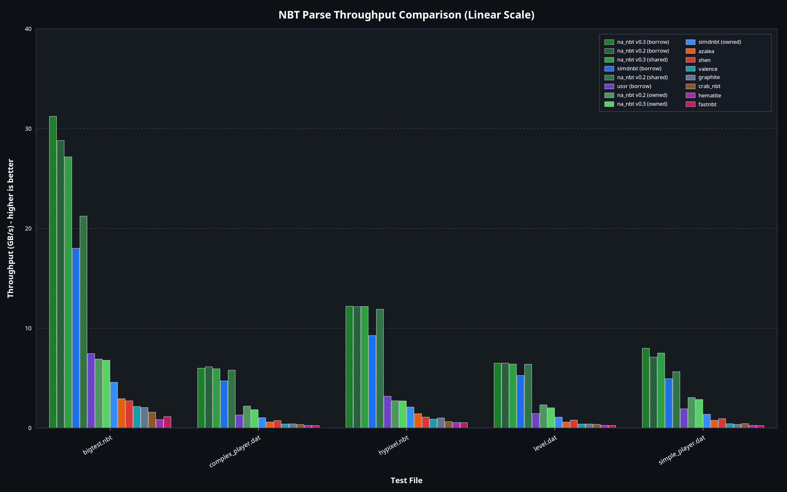

# na_nbt

A high-performance NBT (Named Binary Tag) library for Rust with zero-copy parsing, flat-buffer owned mutation, and seamless Serde integration.
See [documentation](https://docs.rs/na_nbt) for full API details.

> ⚠️ **Note:** This crate is under active development. APIs may change between versions.
> Issues and contributions are welcome!

## Features

- **Zero-copy parsing** — Read NBT data with [`BorrowedDocument`](https://docs.rs/na_nbt/latest/na_nbt/type.BorrowedDocument.html) / [`SharedDocument`](https://docs.rs/na_nbt/latest/na_nbt/type.SharedDocument.html); small NBT documents (up to 8 containers) perform **zero heap allocations**
- **Flat-buffer owned DOM** — Build and mutate [`Compound`](https://docs.rs/na_nbt/latest/na_nbt/struct.Compound.html), [`List`](https://docs.rs/na_nbt/latest/na_nbt/struct.List.html), [`TypedList`](https://docs.rs/na_nbt/latest/na_nbt/struct.TypedList.html), and [`Value`](https://docs.rs/na_nbt/latest/na_nbt/enum.Value.html) in place
- **Ergonomic navigation & list views** — Chainable `at()` path queries, direct NBT-named getters (`get_int`, `get_str`, `get_string`, `get_compound`, ...), zero-copy list slices (`bytes`, `ints`, ...), and single-dispatch [`ListKind`](https://docs.rs/na_nbt/latest/na_nbt/enum.ListKind.html)
- **Serde + DOM interoperability** — Derive `Serialize` / `Deserialize` on Rust structs and freely embed `Compound`, `Value`, `TypedList<T>`, `MUTF8String`, `&'a MUTF8Str`, or zero-copy `BorrowedDocument<'a>`
- **Endianness & root formats** — Convert between `BigEndian` (Java Edition) and `LittleEndian` (Bedrock Edition) on read or write, with full support for named roots and Minecraft 1.20.2+ nameless network roots

## Installation

```toml
[dependencies]
na_nbt = "0.2"
```

### Optional Features

`serde`, `shared`, and `i128` are enabled by default. To customize features:

```toml
[dependencies]
na_nbt = { version = "0.2", default-features = false }

# Or enable only what you need:
na_nbt = { version = "0.2", default-features = false, features = ["serde"] }
```

| Feature   | Default | Description                                                          | Dependencies |
| --------- | ------- | -------------------------------------------------------------------- | ------------ |
| `serde`   | Yes     | Serialize/deserialize Rust types and hybrid DOM structures           | `serde`      |
| `shared`  | Yes     | `SharedDocument` backed by reference-counted `bytes::Bytes`          | `bytes`      |
| `i128`    | Yes     | Map `i128` / `u128` (e.g. Minecraft UUIDs) to 4-element `IntArray`   | —            |
| `nightly` | No      | Enable nightly SIMD acceleration in `simd_cesu8`                     | —            |

## Quick Start

### 1. Zero-Copy Borrowed Reading

```rust
use na_nbt::read_borrowed_be;

fn inspect(bytes: &[u8]) -> na_nbt::Result<()> {
    let doc = read_borrowed_be(bytes)?;

    // Chainable `at()` returns `ValueRef::End` on missing keys or out-of-bounds indices
    let health = doc.at("Player").at("Health").as_short().unwrap_or(20);
    let first_x = doc.at("Player").at("Pos").at(0).as_double();

    // Direct typed getters and zero-copy list views
    if let Some(items) = doc.get_list("Inventory").and_then(|l| l.compounds()) {
        for item in items {
            let id = item.get_str("id");
            let count = item.get_byte("Count").unwrap_or(1);
            let _ = (health, first_x, id, count);
        }
    }
    Ok(())
}
```

### 2. Owned Building & In-Place Mutation

```rust
use na_nbt::{Compound, TypedList};

let mut player = Compound::new();
player.insert("Name", "Alex");
player.insert("Health", 20i16);

let mut pos = TypedList::<f64>::new();
pos.extend_from_slice(&[100.5, 64.0, -200.25]);
player.insert("Pos", pos);

if let Some(mut hp) = player.get_short_mut("Health") {
    *hp -= 4;
}

// Standard root (`[tag_id][name_len][name][payload]`) or 1.20.2+ nameless network root:
let bytes = player.write_to_vec_be();
let network_bytes = player.write_nameless_to_vec_be();
```

### 3. Serde + Hybrid DOM

```rust
use na_nbt::{from_slice_be, to_vec_be, BorrowedDocument, Compound};
use serde::{Deserialize, Serialize};

#[derive(Serialize, Deserialize)]
struct ItemSlot<'a> {
    id: &'a str,
    count: i8,
    // Keep dynamic or version-dependent subtrees as zero-copy `BorrowedDocument` or mutable `Compound`!
    #[serde(borrow)]
    components: BorrowedDocument<'a>,
    #[serde(flatten)]
    extra: Compound,
}
```

## Todo

- [x] **More convenient APIs**
- [x] **Documentation**
- [x] **Tests and fuzzing**
- [ ] **MSRV testing**
- [ ] **`no_std` support**
- [ ] **Older Rust support**

## Benchmarks

na_nbt is the fastest NBT library in Rust. Tests are from simdnbt's benchmark.

### Read Performance




| Library          | bigtest.nbt     | complex_player.dat | hypixel.nbt     | inttest1023.nbt  | level.dat       | longtest1024.nbt | simple_player.dat |
| ---------------- | --------------- | ------------------ | --------------- | ---------------- | --------------- | ---------------- | ----------------- |
| na_nbt (borrow)  | 30.15 GB/s (#1) | 6.36 GB/s (#1)     | 12.66 GB/s (#1) | 227.00 GB/s (#1) | 6.82 GB/s (#1)  | 592.45 GB/s (#1) | 7.24 GB/s (#1)    |
| na_nbt (shared)  | 22.24 GB/s (#2) | 6.06 GB/s (#2)     | 12.25 GB/s (#2) | 102.60 GB/s (#4) | 6.58 GB/s (#2)  | 220.53 GB/s (#4) | 5.98 GB/s (#2)    |
| simdnbt (borrow) | 18.56 GB/s (#3) | 4.89 GB/s (#3)     | 9.45 GB/s (#3)  | 150.84 GB/s (#3) | 5.38 GB/s (#3)  | 302.32 GB/s (#3) | 4.97 GB/s (#3)    |
| ussr (borrow)    | 7.42 GB/s (#4)  | 1.34 GB/s (#5)     | 3.19 GB/s (#4)  | 166.68 GB/s (#2) | 1.52 GB/s (#5)  | 365.88 GB/s (#2) | 2.09 GB/s (#5)    |
| shen             | 2.82 GB/s (#7)  | 0.72 GB/s (#7)     | 1.08 GB/s (#8)  | 0.78 GB/s (#9)   | 0.77 GB/s (#7)  | 22.34 GB/s (#6)  | 0.95 GB/s (#7)    |
| valence          | 1.92 GB/s (#10) | 0.39 GB/s (#10)    | 0.82 GB/s (#10) | 5.93 GB/s (#7)   | 0.40 GB/s (#10) | 11.35 GB/s (#10) | 0.44 GB/s (#9)    |
| azalea           | 2.73 GB/s (#8)  | 0.59 GB/s (#8)     | 1.25 GB/s (#7)  | 2.78 GB/s (#8)   | 0.59 GB/s (#8)  | 11.30 GB/s (#11) | 0.71 GB/s (#8)    |
| crab_nbt         | 1.28 GB/s (#11) | 0.29 GB/s (#11)    | 0.51 GB/s (#11) | 0.30 GB/s (#12)  | 0.31 GB/s (#11) | 15.67 GB/s (#8)  | 0.35 GB/s (#11)   |
| graphite         | 2.06 GB/s (#9)  | 0.46 GB/s (#9)     | 1.00 GB/s (#9)  | 0.66 GB/s (#10)  | 0.47 GB/s (#9)  | 11.35 GB/s (#9)  | 0.43 GB/s (#10)   |
| hematite         | 0.74 GB/s (#13) | 0.21 GB/s (#13)    | 0.43 GB/s (#13) | 0.31 GB/s (#11)  | 0.21 GB/s (#13) | 11.06 GB/s (#12) | 0.21 GB/s (#13)   |
| fastnbt          | 1.05 GB/s (#12) | 0.22 GB/s (#12)    | 0.47 GB/s (#12) | 0.23 GB/s (#13)  | 0.22 GB/s (#12) | 5.57 GB/s (#13)  | 0.22 GB/s (#12)   |
| na_nbt (owned)   | 6.69 GB/s (#5)  | 2.09 GB/s (#4)     | 2.51 GB/s (#5)  | 68.12 GB/s (#5)  | 2.18 GB/s (#4)  | 63.41 GB/s (#5)  | 2.76 GB/s (#4)    |
| simdnbt (owned)  | 3.88 GB/s (#6)  | 0.86 GB/s (#6)     | 1.74 GB/s (#6)  | 19.04 GB/s (#6)  | 0.93 GB/s (#6)  | 17.26 GB/s (#7)  | 1.18 GB/s (#6)    |

### Write Performance


| Library          | bigtest.nbt     | complex_player.dat | hypixel.nbt      | inttest1023.nbt  | level.dat        | longtest1024.nbt | simple_player.dat |
| ---------------- | --------------- | ------------------ | ---------------- | ---------------- | ---------------- | ---------------- | ----------------- |
| na_nbt (borrow)  | 93.53 GB/s (#2) | 174.44 GB/s (#1)   | 212.71 GB/s (#1) | 190.49 GB/s (#2) | 194.11 GB/s (#1) | 243.76 GB/s (#1) | 75.54 GB/s (#2)   |
| na_nbt (shared)  | 93.97 GB/s (#1) | 174.32 GB/s (#2)   | 207.66 GB/s (#2) | 191.10 GB/s (#1) | 187.29 GB/s (#2) | 243.46 GB/s (#2) | 77.02 GB/s (#1)   |
| na_nbt (owned)   | 9.11 GB/s (#3)  | 4.44 GB/s (#3)     | 6.30 GB/s (#3)   | 52.17 GB/s (#3)  | 4.59 GB/s (#3)   | 47.06 GB/s (#3)  | 4.29 GB/s (#3)    |
| simdnbt (borrow) | 7.37 GB/s (#5)  | 2.82 GB/s (#5)     | 5.39 GB/s (#5)   | 21.45 GB/s (#4)  | 3.07 GB/s (#5)   | 27.39 GB/s (#4)  | 2.79 GB/s (#4)    |
| simdnbt (owned)  | 7.29 GB/s (#6)  | 3.26 GB/s (#4)     | 5.89 GB/s (#4)   | 10.75 GB/s (#5)  | 3.40 GB/s (#4)   | 10.93 GB/s (#5)  | 2.75 GB/s (#5)    |
| azalea           | 6.30 GB/s (#7)  | 2.60 GB/s (#7)     | 5.22 GB/s (#7)   | 6.44 GB/s (#6)   | 2.78 GB/s (#7)   | 8.98 GB/s (#7)   | 2.26 GB/s (#7)    |
| graphite         | 7.97 GB/s (#4)  | 2.67 GB/s (#6)     | 5.24 GB/s (#6)   | 2.01 GB/s (#7)   | 2.93 GB/s (#6)   | 10.27 GB/s (#6)  | 2.56 GB/s (#6)    |

### Parse Performance


| Library  | hypixel.nbt    |
| -------- | -------------- |
| na_nbt   | 1.13 GB/s (#1) |
| simdnbt  | 1.00 GB/s (#2) |
| azalea   | 0.43 GB/s (#3) |
| graphite | 0.32 GB/s (#4) |

---

_Higher throughput (GB/s) is better._

## Contributing

This crate is under active development. Contributions are welcome!

- **Bug reports**: Please open an issue with a minimal reproducible example
- **Feature requests**: Open an issue describing the use case
- **Pull requests**: Fork the repo, make your changes, and submit a PR

## License

MIT OR Apache-2.0
