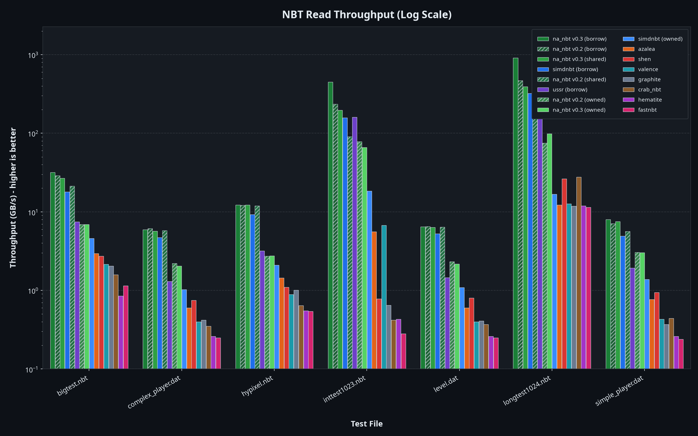
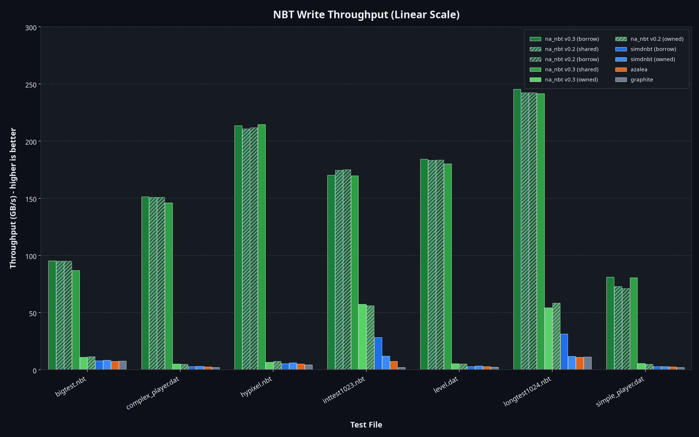
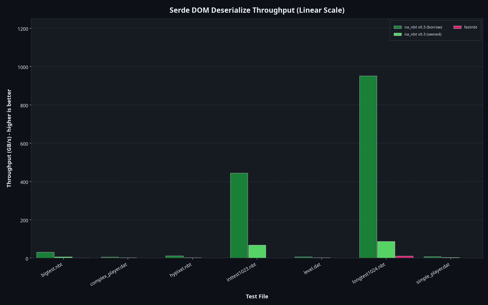
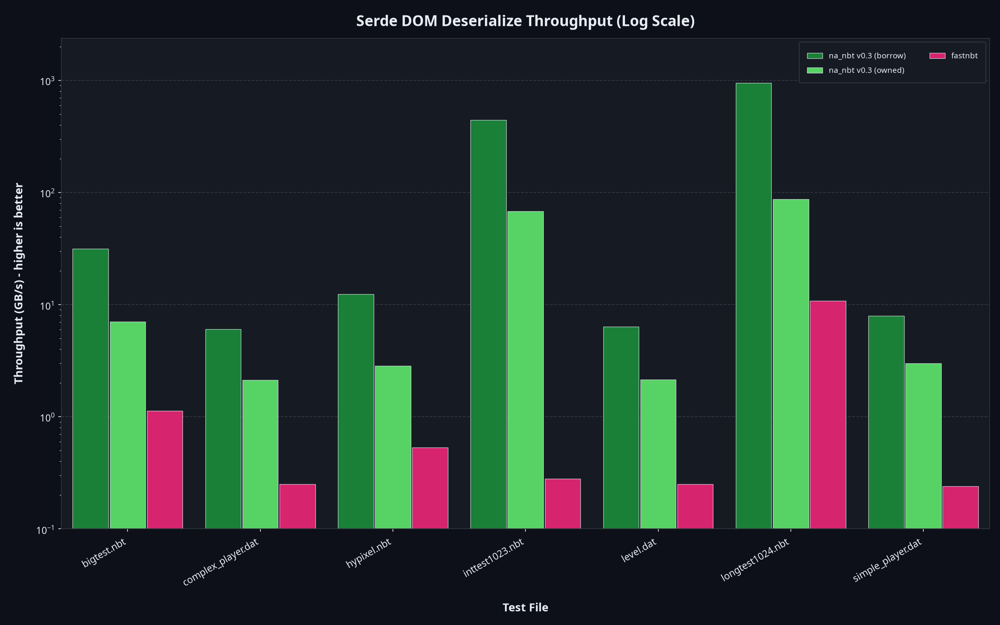
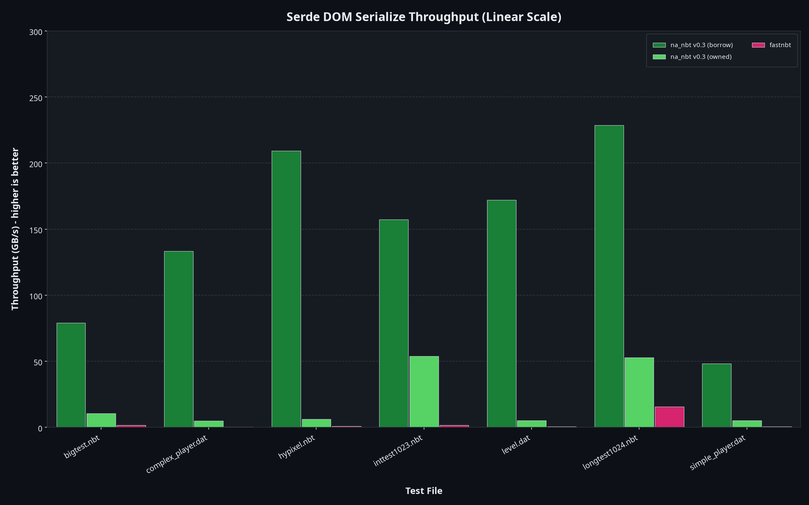
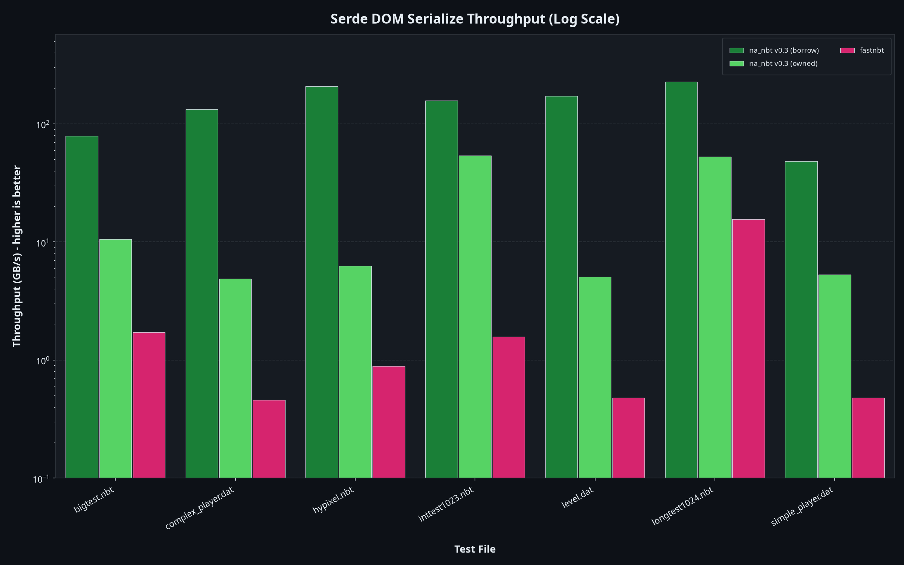
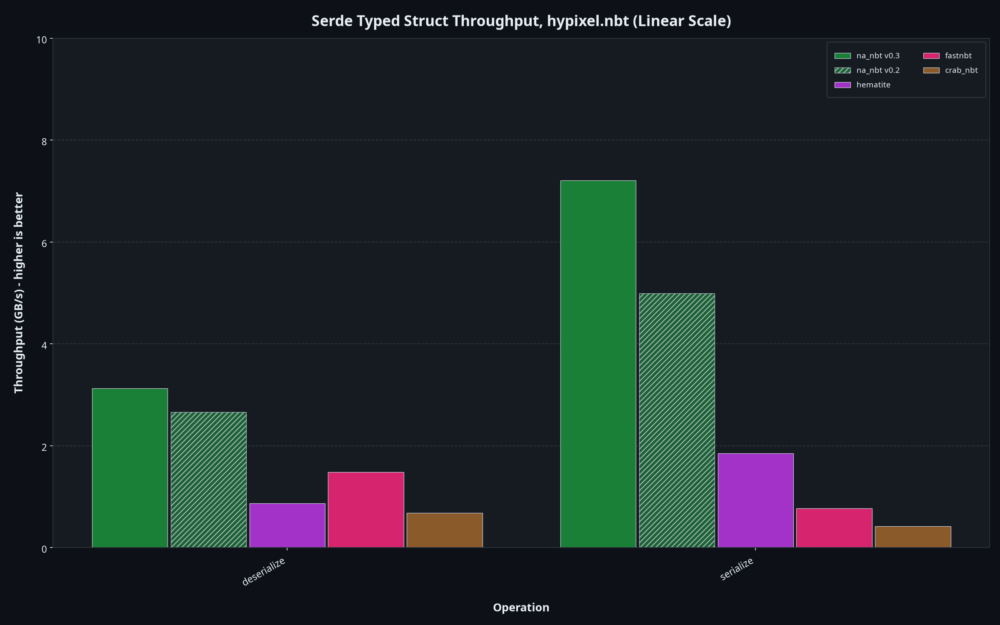

# na_nbt

A high-performance NBT (Named Binary Tag) library for Rust with zero-copy parsing, flat-buffer owned mutation, and seamless Serde integration.
See [documentation](https://docs.rs/na_nbt) for full API details.

> ⚠️ **Note:** This crate is under active development. APIs may change between versions.
> Issues and contributions are welcome!

## Features

- **Zero-copy parsing** — Read NBT data with [`BorrowedDocument`](https://docs.rs/na_nbt/latest/na_nbt/type.BorrowedDocument.html) / [`SharedDocument`](https://docs.rs/na_nbt/latest/na_nbt/type.SharedDocument.html); small NBT documents (up to 8 containers) perform **zero heap allocations**
- **Flat-buffer owned DOM** — Build and mutate [`Compound`](https://docs.rs/na_nbt/latest/na_nbt/struct.Compound.html), [`List`](https://docs.rs/na_nbt/latest/na_nbt/struct.List.html), [`TypedList`](https://docs.rs/na_nbt/latest/na_nbt/struct.TypedList.html), and [`Value`](https://docs.rs/na_nbt/latest/na_nbt/enum.Value.html) in place
- **Ergonomic navigation & list views** — Chainable `at()` path queries, direct NBT-named getters (`get_int`, `get_str`, `get_string`, `get_compound`, ...), zero-copy list slices (`bytes`, `ints`, ...), and single-dispatch [`ListKind`](https://docs.rs/na_nbt/latest/na_nbt/enum.ListKind.html)
- **Serde + DOM interoperability** — Derive `Serialize` / `Deserialize` on Rust structs and freely embed `Compound`, `Value`, `TypedList<T>`, `MUTF8String`, `&'a MUTF8Str`, or zero-copy `BorrowedDocument<'a>`; embedded DOM values are written by the native tree writer rather than field by field
- **Endianness & root formats** — Convert between `BigEndian` (Java Edition) and `LittleEndian` (Bedrock Edition) on read or write, with full support for named roots and Minecraft 1.20.2+ nameless network roots

## Installation

```toml
[dependencies]
na_nbt = "0.3"
```

### Optional Features

`serde`, `shared`, and `i128` are enabled by default. To customize features:

```toml
[dependencies]
na_nbt = { version = "0.3", default-features = false }

# Or enable only what you need:
na_nbt = { version = "0.3", default-features = false, features = ["serde"] }
```

| Feature   | Default | Description                                                          | Dependencies |
| --------- | ------- | -------------------------------------------------------------------- | ------------ |
| `serde`   | Yes     | Serialize/deserialize Rust types and hybrid DOM structures           | `serde`      |
| `shared`  | Yes     | `SharedDocument` backed by reference-counted `bytes::Bytes`          | `bytes`      |
| `i128`    | Yes     | Map `i128` / `u128` (e.g. Minecraft UUIDs) to 4-element `IntArray`   | —            |
| `nightly` | No      | Enable nightly SIMD acceleration in `simd_cesu8`                     | —            |

## Quick Start

### 1. Zero-Copy Borrowed Reading

```rust
use na_nbt::read_borrowed_be;

fn inspect(bytes: &[u8]) -> na_nbt::Result<()> {
    let doc = read_borrowed_be(bytes)?;

    // Chainable `at()` returns `ValueRef::End` on missing keys or out-of-bounds indices
    let health = doc.at("Player").at("Health").as_short().unwrap_or(20);
    let first_x = doc.at("Player").at("Pos").at(0).as_double();

    // Direct typed getters and zero-copy list views
    if let Some(items) = doc.get_list("Inventory").and_then(|l| l.compounds()) {
        for item in items {
            let id = item.get_str("id");
            let count = item.get_byte("Count").unwrap_or(1);
            let _ = (health, first_x, id, count);
        }
    }
    Ok(())
}
```

### 2. Owned Building & In-Place Mutation

```rust
use na_nbt::{Compound, TypedList};

let mut player = Compound::new();
player.insert("Name", "Alex");
player.insert("Health", 20i16);

let mut pos = TypedList::<f64>::new();
pos.extend_from_slice(&[100.5, 64.0, -200.25]);
player.insert("Pos", pos);

if let Some(mut hp) = player.get_short_mut("Health") {
    *hp -= 4;
}

// Standard root (`[tag_id][name_len][name][payload]`) or 1.20.2+ nameless network root:
let bytes = player.write_to_vec_be();
let network_bytes = player.write_nameless_to_vec_be();
```

### 3. Serde + Hybrid DOM

```rust
use na_nbt::{from_slice_be, to_vec_be, BorrowedDocument, Compound};
use serde::{Deserialize, Serialize};

#[derive(Serialize, Deserialize)]
struct ItemSlot<'a> {
    id: &'a str,
    count: i8,
    // Keep dynamic or version-dependent subtrees as zero-copy `BorrowedDocument` or mutable `Compound`!
    #[serde(borrow)]
    components: BorrowedDocument<'a>,
    // Note: `#[serde(flatten)]` buffers through serde's generic `Content`, so flattened
    // `IntArray` / `LongArray` fields deserialize as `List` rather than typed arrays.
    #[serde(flatten)]
    extra: Compound,
}
```

## Benchmarks

na_nbt is the fastest NBT library in Rust. The suite is adapted from [`simdnbt`](https://github.com/azalea-rs/simdnbt)'s benchmarks and covers raw reading and writing, extracting data into Rust structs, and serde.

- [Read](#read) · [Write](#write) · [Parse + Extract](#parse--extract-hypixelnbt) · [Serde](#serde)

**Methodology**

- Intel Core i9-14900KF, Linux; [criterion](https://github.com/bheisler/criterion.rs) with LTO, pinned to a single P-core. The Read, Write and Serde suites use `mimalloc` as the global allocator; Parse + Extract uses the system allocator.
- Inputs are the NBT files of the simdnbt suite, decompressed beforehand. Throughput is the uncompressed input size divided by the time per iteration, in GB/s (10⁹ bytes); **higher is better**. `(#n)` is the rank within a column.
- `na_nbt v0.3` and `na_nbt v0.2` are both listed for a direct version comparison. The `na_nbt v0.3` rows and the serde section come from a later run on the same machine than the other rows.

**na_nbt variants**

| Variant  | API                                   | Representation                                               |
| -------- | ------------------------------------- | ------------------------------------------------------------ |
| `borrow` | `read_borrowed` → `BorrowedDocument`  | Zero-copy view over `&[u8]`                                  |
| `shared` | `read_shared` → `SharedDocument`      | Zero-copy view over reference-counted `bytes::Bytes`         |
| `owned`  | `read_owned` → `Value` / `Compound`   | Mutable owned tree                                           |

<details>
<summary>Reproducing</summary>

```sh
cd bench
cargo bench --no-run            # build first (nightly toolchain, see bench/rust-toolchain)
taskset -c 6 cargo bench        # all suites; or --bench compare | compare_hypixel | compare_serde
cd .. && python bench/charts.py # re-rank the README tables and redraw images/ (needs matplotlib)
```

`bench/charts.py` treats the README tables as its data: update the `GB/s` numbers, run it, and it recomputes ranks, row order and every chart.

</details>

### Read

Parse a complete document from bytes.




| Library              | bigtest.nbt     | complex_player.dat | hypixel.nbt     | inttest1023.nbt  | level.dat       | longtest1024.nbt | simple_player.dat |
| -------------------- | --------------- | ------------------ | --------------- | ---------------- | --------------- | ---------------- | ----------------- |
| na_nbt v0.3 (borrow) | 31.72 GB/s (#1) | 5.95 GB/s (#2)     | 12.25 GB/s (#1) | 451.29 GB/s (#1) | 6.48 GB/s (#2)  | 909.16 GB/s (#1) | 8.00 GB/s (#1)    |
| na_nbt v0.2 (borrow) | 28.82 GB/s (#2) | 6.14 GB/s (#1)     | 12.16 GB/s (#3) | 235.46 GB/s (#2) | 6.50 GB/s (#1)  | 468.34 GB/s (#2) | 7.10 GB/s (#3)    |
| na_nbt v0.3 (shared) | 26.69 GB/s (#3) | 5.71 GB/s (#4)     | 12.21 GB/s (#2) | 196.27 GB/s (#3) | 6.37 GB/s (#4)  | 391.19 GB/s (#3) | 7.53 GB/s (#2)    |
| simdnbt (borrow)     | 18.01 GB/s (#5) | 4.72 GB/s (#5)     | 9.27 GB/s (#5)  | 157.57 GB/s (#5) | 5.26 GB/s (#5)  | 321.75 GB/s (#5) | 4.94 GB/s (#5)    |
| na_nbt v0.2 (shared) | 21.24 GB/s (#4) | 5.80 GB/s (#3)     | 11.91 GB/s (#4) | 90.80 GB/s (#6)  | 6.39 GB/s (#3)  | 180.72 GB/s (#6) | 5.65 GB/s (#4)    |
| ussr (borrow)        | 7.46 GB/s (#6)  | 1.30 GB/s (#8)     | 3.18 GB/s (#6)  | 160.16 GB/s (#4) | 1.45 GB/s (#8)  | 352.18 GB/s (#4) | 1.93 GB/s (#8)    |
| na_nbt v0.2 (owned)  | 6.91 GB/s (#8)  | 2.20 GB/s (#6)     | 2.73 GB/s (#8)  | 78.44 GB/s (#7)  | 2.32 GB/s (#6)  | 75.38 GB/s (#8)  | 3.05 GB/s (#6)    |
| na_nbt v0.3 (owned)  | 6.93 GB/s (#7)  | 2.05 GB/s (#7)     | 2.76 GB/s (#7)  | 66.36 GB/s (#8)  | 2.18 GB/s (#7)  | 98.72 GB/s (#7)  | 3.02 GB/s (#7)    |
| simdnbt (owned)      | 4.59 GB/s (#9)  | 1.03 GB/s (#9)     | 2.10 GB/s (#9)  | 18.41 GB/s (#9)  | 1.09 GB/s (#9)  | 16.84 GB/s (#11) | 1.38 GB/s (#9)    |
| azalea               | 2.94 GB/s (#10) | 0.60 GB/s (#11)    | 1.44 GB/s (#10) | 5.59 GB/s (#11)  | 0.60 GB/s (#11) | 12.21 GB/s (#13) | 0.77 GB/s (#11)   |
| shen                 | 2.73 GB/s (#11) | 0.75 GB/s (#10)    | 1.10 GB/s (#11) | 0.78 GB/s (#12)  | 0.80 GB/s (#10) | 26.45 GB/s (#10) | 0.94 GB/s (#10)   |
| valence              | 2.16 GB/s (#12) | 0.40 GB/s (#13)    | 0.89 GB/s (#13) | 6.77 GB/s (#10)  | 0.40 GB/s (#13) | 12.67 GB/s (#12) | 0.43 GB/s (#13)   |
| graphite             | 2.05 GB/s (#13) | 0.42 GB/s (#12)    | 1.01 GB/s (#12) | 0.65 GB/s (#13)  | 0.41 GB/s (#12) | 11.83 GB/s (#15) | 0.37 GB/s (#14)   |
| crab_nbt             | 1.59 GB/s (#14) | 0.35 GB/s (#14)    | 0.64 GB/s (#14) | 0.42 GB/s (#15)  | 0.37 GB/s (#14) | 27.75 GB/s (#9)  | 0.44 GB/s (#12)   |
| hematite             | 0.85 GB/s (#16) | 0.26 GB/s (#15)    | 0.55 GB/s (#15) | 0.43 GB/s (#14)  | 0.26 GB/s (#15) | 11.91 GB/s (#14) | 0.26 GB/s (#15)   |
| fastnbt              | 1.15 GB/s (#15) | 0.25 GB/s (#16)    | 0.54 GB/s (#16) | 0.28 GB/s (#16)  | 0.25 GB/s (#16) | 11.48 GB/s (#16) | 0.24 GB/s (#16)   |

### Write

Serialize a parsed document back to bytes in the same byte order.




| Library              | bigtest.nbt     | complex_player.dat | hypixel.nbt      | inttest1023.nbt  | level.dat        | longtest1024.nbt | simple_player.dat |
| -------------------- | --------------- | ------------------ | ---------------- | ---------------- | ---------------- | ---------------- | ----------------- |
| na_nbt v0.3 (borrow) | 95.45 GB/s (#1) | 151.31 GB/s (#1)   | 213.63 GB/s (#2) | 170.38 GB/s (#3) | 184.33 GB/s (#1) | 245.45 GB/s (#1) | 81.03 GB/s (#1)   |
| na_nbt v0.2 (shared) | 95.10 GB/s (#2) | 150.85 GB/s (#3)   | 210.77 GB/s (#4) | 174.65 GB/s (#2) | 183.31 GB/s (#3) | 242.49 GB/s (#2) | 72.93 GB/s (#3)   |
| na_nbt v0.2 (borrow) | 95.06 GB/s (#3) | 150.88 GB/s (#2)   | 211.73 GB/s (#3) | 175.07 GB/s (#1) | 183.43 GB/s (#2) | 242.32 GB/s (#3) | 71.08 GB/s (#4)   |
| na_nbt v0.3 (shared) | 87.01 GB/s (#4) | 146.14 GB/s (#4)   | 214.58 GB/s (#1) | 169.78 GB/s (#4) | 180.16 GB/s (#4) | 241.66 GB/s (#4) | 80.70 GB/s (#2)   |
| na_nbt v0.3 (owned)  | 11.16 GB/s (#6) | 5.22 GB/s (#5)     | 6.82 GB/s (#6)   | 57.42 GB/s (#5)  | 5.55 GB/s (#5)   | 54.43 GB/s (#6)  | 5.77 GB/s (#5)    |
| na_nbt v0.2 (owned)  | 11.52 GB/s (#5) | 4.96 GB/s (#6)     | 7.39 GB/s (#5)   | 56.08 GB/s (#6)  | 5.17 GB/s (#6)   | 58.49 GB/s (#5)  | 4.84 GB/s (#6)    |
| simdnbt (borrow)     | 8.05 GB/s (#8)  | 2.78 GB/s (#8)     | 5.36 GB/s (#8)   | 28.31 GB/s (#7)  | 2.99 GB/s (#8)   | 31.37 GB/s (#7)  | 2.93 GB/s (#8)    |
| simdnbt (owned)      | 8.49 GB/s (#7)  | 3.20 GB/s (#7)     | 6.11 GB/s (#7)   | 11.95 GB/s (#8)  | 3.36 GB/s (#7)   | 11.85 GB/s (#8)  | 2.99 GB/s (#7)    |
| azalea               | 7.37 GB/s (#10) | 2.61 GB/s (#9)     | 5.29 GB/s (#9)   | 7.42 GB/s (#9)   | 2.86 GB/s (#9)   | 11.08 GB/s (#10) | 2.55 GB/s (#9)    |
| graphite             | 7.80 GB/s (#9)  | 2.03 GB/s (#10)    | 4.52 GB/s (#10)  | 2.19 GB/s (#10)  | 2.27 GB/s (#10)  | 11.24 GB/s (#9)  | 2.21 GB/s (#10)   |

### Parse + Extract (hypixel.nbt)

Parse `hypixel.nbt` and pull every item's fields into Rust structs through each library's navigation API (simdnbt's `hypixel` benchmark; all libraries produce identical results).


| Library     | hypixel.nbt    |
| ----------- | -------------- |
| na_nbt v0.3 | 2.13 GB/s (#1) |
| na_nbt v0.2 | 1.60 GB/s (#2) |
| simdnbt     | 1.41 GB/s (#3) |
| azalea      | 0.54 GB/s (#4) |
| graphite    | 0.31 GB/s (#5) |

### Serde

Round trips through each library's serde data format (`bench/benches/compare_serde.rs`).

#### DOM Deserialize

NBT bytes deserialized into the library's dynamic value type: `na_nbt::from_slice_be::<BorrowedDocument>` (`borrow`) or `::<Value>` (`owned`), and `fastnbt::from_bytes::<fastnbt::Value>`.




| Library              | bigtest.nbt     | complex_player.dat | hypixel.nbt     | inttest1023.nbt  | level.dat      | longtest1024.nbt | simple_player.dat |
| -------------------- | --------------- | ------------------ | --------------- | ---------------- | -------------- | ---------------- | ----------------- |
| na_nbt v0.3 (borrow) | 31.44 GB/s (#1) | 6.05 GB/s (#1)     | 12.37 GB/s (#1) | 443.69 GB/s (#1) | 6.34 GB/s (#1) | 951.23 GB/s (#1) | 7.94 GB/s (#1)    |
| na_nbt v0.3 (owned)  | 7.05 GB/s (#2)  | 2.12 GB/s (#2)     | 2.85 GB/s (#2)  | 68.02 GB/s (#2)  | 2.15 GB/s (#2) | 87.34 GB/s (#2)  | 2.99 GB/s (#2)    |
| fastnbt              | 1.13 GB/s (#3)  | 0.25 GB/s (#3)     | 0.53 GB/s (#3)  | 0.28 GB/s (#3)   | 0.25 GB/s (#3) | 10.83 GB/s (#3)  | 0.24 GB/s (#3)    |

#### DOM Serialize

The same dynamic values serialized back to NBT with `na_nbt::to_vec_be` and `fastnbt::to_bytes`. A DOM value handed to na_nbt's own serializer is written by its tree writer directly, so a borrowed document reaches 60–98% of the direct `write_to_vec` throughput in the [Write](#write) table.




| Library              | bigtest.nbt     | complex_player.dat | hypixel.nbt      | inttest1023.nbt  | level.dat        | longtest1024.nbt | simple_player.dat |
| -------------------- | --------------- | ------------------ | ---------------- | ---------------- | ---------------- | ---------------- | ----------------- |
| na_nbt v0.3 (borrow) | 78.97 GB/s (#1) | 133.38 GB/s (#1)   | 209.22 GB/s (#1) | 157.26 GB/s (#1) | 171.96 GB/s (#1) | 228.57 GB/s (#1) | 48.31 GB/s (#1)   |
| na_nbt v0.3 (owned)  | 10.57 GB/s (#2) | 4.88 GB/s (#2)     | 6.25 GB/s (#2)   | 53.82 GB/s (#2)  | 5.05 GB/s (#2)   | 52.83 GB/s (#2)  | 5.28 GB/s (#2)    |
| fastnbt              | 1.72 GB/s (#3)  | 0.46 GB/s (#3)     | 0.89 GB/s (#3)   | 1.57 GB/s (#3)   | 0.48 GB/s (#3)   | 15.62 GB/s (#3)  | 0.48 GB/s (#3)    |

Only libraries whose dynamic values survive a serde round trip unchanged are listed: na_nbt v0.2 has no serde support for its DOM types, hematite's `Blob` narrows numbers to the smallest type that fits (and produces unreadable output for `inttest1023.nbt`), and crab_nbt turns byte arrays into lists.

#### Typed Struct (hypixel.nbt)

A `#[derive(Serialize, Deserialize)]` struct with owned `String` fields describing the Hypixel item list (na_nbt fields use `#[serde(with = "na_nbt::list")]` for NBT lists). All libraries produce identical NBT.



| Library     | deserialize    | serialize      |
| ----------- | -------------- | -------------- |
| na_nbt v0.3 | 3.13 GB/s (#1) | 7.21 GB/s (#1) |
| na_nbt v0.2 | 2.66 GB/s (#2) | 4.99 GB/s (#2) |
| hematite    | 0.87 GB/s (#4) | 1.85 GB/s (#3) |
| fastnbt     | 1.48 GB/s (#3) | 0.77 GB/s (#4) |
| crab_nbt    | 0.68 GB/s (#5) | 0.42 GB/s (#5) |

## Todo

- [x] **More convenient APIs**
- [x] **Documentation**
- [x] **Tests and fuzzing**
- [ ] **MSRV testing**
- [ ] **`no_std` support**
- [ ] **Older Rust support**

## Contributing

This crate is under active development. Contributions are welcome!

- **Bug reports**: Please open an issue with a minimal reproducible example
- **Feature requests**: Open an issue describing the use case
- **Pull requests**: Fork the repo, make your changes, and submit a PR

## License

MIT OR Apache-2.0
